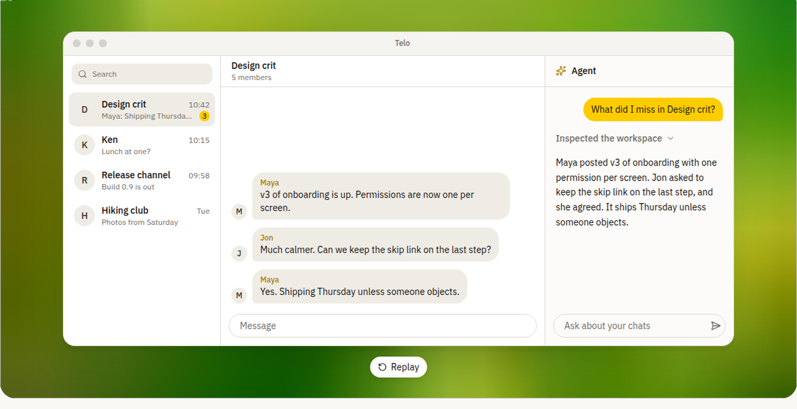

# Telo

由 AstraFoundry 打造的隐私优先 Telegram 桌面客户端，在对话旁内置具备工作区上下文感知能力的 AI 智能体。

[](README.md)
[](README.zh-CN.md)
[](README.ja.md)
[](LICENSE)
[](mygo.json)
[](go.mod)
[](go.mod)




## 核心特性

- **原生单进程**：使用 Go 基于 [MyGo](https://github.com/egoist/mygo) 编写：原生窗口，无 Electron、无 WebView、无需 C 工具链。TDLib 1.8.67 通过 `purego` 加载，每个账号的数据库由系统凭据存储中的密钥加密；支持最多 3 个账号、私密聊天、服务端与关键词文件夹、投票、定时消息与贴纸。（`prebuilt-tdlib` 不支持 Windows arm64。）
- **对齐 Telegram for macOS**：交互对齐 [telegram-macos](https://github.com/TelegramMessenger/telegram-macos)：菜单、快捷键、设置项与右键菜单都标注了所对应的上游条目；一旦 Telo 偏离已提交的对齐台账，`make check` 即失败。
- **工作区上下文感知 AI 智能体**：右侧面板（`⌘J` / `Ctrl+J`）可总结未读讨论、提炼决策与待办、将翻译 / 改写 / 回复草稿写入输入框、以带编号的 `telo://message/...` 链接引用消息，并运行触发规则与定时任务（默认 `draft-only`，或 `auto-send`）。
- **自带账号接入（BYOA）**：支持 OpenAI、Anthropic、Google、Groq、xAI、Kimi、DeepSeek 与 Mistral（OpenAI、Anthropic、Google、xAI、Kimi 支持厂商登录，其余使用 API Key），以及任意兼容 OpenAI 协议的 HTTPS 接口。
- **密钥始终加密**：API Key、OAuth 令牌与 Telegram 数据库密钥以 AES-256-GCM 加密，密钥保存在系统凭据存储中，绝不进入界面层。智能体上下文在离开设备前自动脱敏（邮箱、手机号、API Key），每次运行仅将提示词的 SHA-256 记录到 `agent-audit.jsonl`，从不记录原文。
- **精致桌面体验**：沿用 AstraFoundry Arion 的 coss 组件结构，配色保持 Telo 独立：跟随系统 / 浅色 / 深色主题、5 套强调色、12–18 px 消息字号、本地密码锁与自动锁定、可搜索的设置，以及按会话类型细分的通知与媒体下载控制。

## 快速开始

### 环境要求

- **Go**：`go.mod` 中声明的版本
- **Node.js** `>= 22.0.0` 与 **pnpm** `9.0.0` 或更高版本（用于准备固定版本的 TDLib 并校验文档）
- **GNU Make**
- **操作系统**：macOS、Windows（x64）或带有图形会话的 Linux

### 安装与运行

```sh
git clone https://github.com/AstraFoundry/telo.git
cd telo
make install
make dev
```

若无需登录真实 Telegram 账号或配置 AI 服务商，直接体验内存演示工作区与确定性演示智能体：

```sh
make demo
```

### Telegram 与 OAuth 凭据配置

如需在本地开发时连接真实 Telegram 账号，请传入从 [my.telegram.org](https://my.telegram.org) 申请的应用凭据（或参考 `.env.example` 写入本地 `.env` 文件）：

```sh
TELO_TELEGRAM_API_ID=1234567 TELO_TELEGRAM_API_HASH=0123456789abcdef0123456789abcdef make dev
```

如需为智能体启用 Google 登录，请提供已开启 Generative Language API 且允许本地回环重定向（`http://127.0.0.1`）的 Google Cloud 桌面端 OAuth 客户端 ID：

```sh
TELO_GOOGLE_OAUTH_CLIENT_ID=123456789.apps.googleusercontent.com make dev
```

OpenAI、Anthropic、xAI 与 Kimi 默认使用各厂商公开的原生 OAuth 客户端，也可通过 `TELO_OPENAI_OAUTH_CLIENT_ID`、`TELO_ANTHROPIC_OAUTH_CLIENT_ID`、`TELO_XAI_OAUTH_CLIENT_ID` 与 `TELO_KIMI_OAUTH_CLIENT_ID` 覆盖。未设置 `TELO_GOOGLE_OAUTH_CLIENT_ID` 时，Google 使用 API Key。

### 常用命令

| 命令 | 说明 |
| --- | --- |
| `make install` | 按 lockfile 安装固定版本的 TDLib 包与文档工具 |
| `make dev` | 准备 TDLib 并以热重载模式运行 Telo |
| `make demo` | 在内存演示工作区中运行 Telo |
| `make reset` | 使用一次性的空白配置运行 Telo |
| `make check` | 运行 CI 的全部门禁：gofmt、vet、生成代码、FSD/DDD 导入、TDLib 能力、telegram-macos 对齐、测试与文档 |
| `make test` | 基于已准备的 libtdjson 运行 Go 测试（含无头 UI 测试） |
| `make parity` | 校验 telegram-macos 对齐台账与代码是否一致 |
| `make snapshots` | 将 UI 测试画面渲染到 `.workspace/snapshots` |
| `make test-live` | 在已登录账号上运行真实 Telegram 基线（`TELO_LIVE_E2E=1`） |
| `make build` | 构建当前平台的 Telo 可执行文件 |
| `make package` | 使用 `mygo build` 构建应用包与安装程序 |
| `make help` | 列出全部目标 |

## 文档索引

- [文档总览](docs/README.md) — 顶层文档地图与使用指南。
- [项目概述](docs/project/README.md) — 产品目标与边界。
- [系统架构](docs/project/architecture.md) — 前端 FSD 分层、后端 DDD 分层、线程模型与数据流。
- [智能体](docs/project/agent.md) — 面板、消息引用、BYOA 模型接入、脱敏与自动化。
- [Telegram](docs/telegram/README.md) — TDLib 能力矩阵与真实账号基线。
- [telegram-macos 对齐](docs/telegram/parity.md) — 对齐台账及 `make check` 中的门禁。
- [前端开发规范 (FSD)](docs/frontend/README.md) — Go 中的 Feature-Sliced Design 与设计系统。
- [后端开发规范 (DDD)](docs/backend/README.md) — 领域驱动设计分层、端口与用例。
- [本地数据持久化](docs/backend/database.md) — 加密文件与按账号划分的 TDLib 存储。
- [本地开发指南](docs/operations/local-dev.md) — 环境变量与运行时配置。
- [构建与发布](docs/operations/deployment.md) — 打包、CI 与发布产物。
- [测试策略](docs/quality/testing.md) — `make check` 的各项门禁与无头 UI 测试。
- [架构决策记录 (ADR)](docs/decisions/README.md) — 涵盖原生桌面、BYOA 服务商、自动化安全、TDLib 内核与对齐范围的决策。

## 贡献者

[](https://github.com/AstraFoundry/telo/graphs/contributors)

## Star 趋势

[](https://star-history.com/#AstraFoundry/telo&Date)

## 开源协议

本项目基于 [MIT 许可证](LICENSE) 开源。

Telo 是由 AstraFoundry 开发的独立第三方客户端，与 Telegram FZ-LLC 或 Telegram Messenger Inc. 不存在隶属、关联、赞助或官方认可关系。
